  

# 🎹 Awesome Digital Audio Workstation (DAW) & MIDI Sequencer 🎚️

  
  
  
  
  

---

## 🧭 Overview & Ecosystem Introduction

A curated collection of top-tier **Digital Audio Workstations (DAWs)**, **MIDI Sequencers**, **Cloud Studio SaaS Platforms**, and **Open-Source Music Production Software**. Whether you are an electronic music producer, audio DSP engineer, game audio composer, or Linux audio enthusiast, this repository indexes the best tools for multi-track audio recording, algorithmic MIDI generation, tracker sequencing, virtual instrument sound design, and cloud music collaboration.

---

## 📈 Sector Overview & Market Dynamics

The global Digital Audio Workstation (DAW) and music creation software market is valued at approximately **$3.1 Billion** (projected to reach over **$5.4 Billion** by 2032 with a ~7.2% CAGR). The market structure exhibits a **moderately fragmented yet tiered** competitive dynamic: traditional pro-audio desktop recording remains concentrated among established industry giants (Avid, Apple, Ableton, Yamaha/Steinberg, and Image-Line), while the rapid emergence of WebAudio, browser-based cloud collaboration, and mobile-first composition (BandLab, Soundtrap, Audiotool) has unlocked millions of bedroom creators and hobbyists alongside a resilient, highly innovative open-source ecosystem (Audacity, LMMS, Ardour, Zrythm).

---

## 📋 Table of Contents

- [🎹 Awesome Digital Audio Workstation (DAW) & MIDI Sequencer 🎚️](#-awesome-digital-audio-workstation-daw--midi-sequencer-️)
  - [🧭 Overview & Ecosystem Introduction](#-overview--ecosystem-introduction)
  - [📈 Sector Overview & Market Dynamics](#-sector-overview--market-dynamics)
  - [📋 Table of Contents](#-table-of-contents)
  - [☁️ SaaS & Hosted Cloud Music Studios](#️-saas--hosted-cloud-music-studios)
  - [💻 Open-Source DAWs & MIDI Sequencer Software](#-open-source-daws--midi-sequencer-software)
    - [🏆 Open-Source Repositories (Ranked by GitHub Stars)](#-open-source-repositories-ranked-by-github-stars)
    - [🔬 Category & Architecture Highlights](#-category--architecture-highlights)
  - [🤝 How to Contribute](#-how-to-contribute)
  - [🌟 Star History](#-star-history)
  - [💖 Support & Sponsorship](#-support--sponsorship)
  - [⚖️ Disclaimer](#️-disclaimer)

---

## ☁️ SaaS & Hosted Cloud Music Studios

*The SaaS/hosted music studio platforms below are sorted descending by company scale (market valuation / parent enterprise revenue).*

| Platform | Description | Scale (Valuation / Revenue) | Pricing | Free Tier / Free Trial Limits |
| :--- | :--- | :--- | :--- | :--- |
| **[Avid Pro Tools Cloud](https://avid.com)** | Industry-standard post-production and commercial recording DAW with Avid Cloud Collaboration. | **~$1.4B Valuation** (Acquired by STG for $1.4B; ~$400M+ ARR) | Starts at **$9.99/mo** (Pro Tools Artist) or **$99/yr** | **30-Day Free Trial** (Fully unlocked Pro Tools Ultimate trial with 1GB cloud collaboration storage, requires Avid account). |
| **[Roland Cloud](https://roland.com)** | Cloud ecosystem delivering authentic ACB component modeling of classic Roland synthesizers, Zenology, and patch libraries. | **~$900M Market Cap** (Roland Corp TYO: 7944, ~$650M+ annual revenue) | Starts at **$2.99/mo** or **$29.99/yr** (Core plan) | **Free Forever Tier**: Roland Cloud Core Free account grants Zenology Lite with 182 instrument presets and limited software rhythm tools; plus a **30-Day Pro/Ultimate Trial**. |
| **[Ableton Cloud](https://ableton.com)** | Cloud-sync service transferring Ableton Note mobile sketches and Live Sets seamlessly across studio desktop workstations. | **~$500M+ Est. Valuation** (~$120M+ annual revenue) | Starts at **$99 one-time** (Live 12 Intro) or **$6.99 one-time** (Ableton Note iOS) | **30-Day Free Trial** (Complete, unrestricted access to Ableton Live 12 Suite including cloud sync, saving, and stem exports for 30 days). |
| **[Soundtrap](https://soundtrap.com)** | Browser-based collaborative online recording DAW and loop-sequencer suite (developed within Spotify's audio ecosystem). | **~$450M Est. Valuation** (Acquired by Spotify NYSE: SPOT; ~$35M+ ARR) | Starts at **$9.99/mo** or **$119.88/yr** (Music Maker plan) | **Free Forever Tier**: Unlimited projects, 5,500+ loops, 490+ virtual instruments/sounds, and standard audio export; plus **14-day free trial** for premium tiers. |
| **[BandLab](https://bandlab.com)** | Mobile and browser multi-track cloud DAW featuring real-time multiplayer co-creation, virtual instruments, and AutoPitch. | **$425M Valuation** (Post-Series B round; 100M+ registered creators) | Starts at **$14.95/mo** or **$149.50/yr** (BandLab Membership) | **Free Forever Tier**: 100% Free unlimited multi-track recording, unlimited cloud project storage, 16 tracks, 330+ MIDI instruments, and royalty-free loops without feature paywalls. |
| **[FL Studio Cloud](https://image-line.com)** | Cloud ecosystem integrated directly into FL Studio providing curated sample libraries, cloud sound packs, and AI mastering. | **~$350M+ Est. Valuation** (~$60M+ annual revenue, Image-Line Software) | Starts at **$9.99/mo** or **$79.99/yr** (FL Cloud Pro) | **Free Forever Tier**: Unlimited basic AI mastering and curated free sound library access with any FL Studio license; plus **30-day all-access free trial** of FL Cloud Pro. |
| **[Audiotool](https://audiotool.com)** | Modular collaborative web DAW with virtual analog synthesizers, drum machines, effect stompboxes, and wire-patch routing. | **~$25M Est. Valuation** (Venture-backed by targeted audio angels; ~$3M ARR) | Starts at **$4.99/mo** or **$49/yr** (Audiotool Pro) | **Free Forever Tier**: Free cloud DAW with unlimited public cloud project saves, real-time collaboration, and complete access to all modular instruments (Pro adds private stems & uncompressed audio). |
| **[Soundation](https://soundation.com)** | Browser-based cloud beat studio with multi-track sequencing, virtual synths, live multi-user collaboration, and audio loops. | **~$15M Est. Valuation** (~$2.5M ARR) | Starts at **$9.99/mo** or **$59.88/yr** (Creator plan) | **Free Forever Tier**: Up to 3 active studio projects, 700+ royalty-free loops, and standard audio export resolution. |
| **[Amped Studio](https://ampedstudio.com)** | WebAssembly-powered web DAW supporting hybrid audio/MIDI tracks, Web VST hosting, hum-to-MIDI pitch detection, and cloud stems. | **~$8M Est. Valuation** (~$1.2M ARR) | Starts at **$4.99/mo** or **$49.99/yr** (Premium plan) | **Free Forever Tier**: Free access to core audio/MIDI sequencer, standard virtual instruments, and cloud storage; plus **14-day free trial** of Premium VST hosting. |
| **[AudioSauna](https://audiosauna.com)** | Classic browser synthesizer and MIDI piano roll workstation featuring FM synthesis and step sequencer architecture. | **~$1.5M Est. Valuation** (Independent audio development studio) | **100% Free** (Completely community web-hosted / ad-supported) | **Free Forever Tier**: Unlimited browser-based synthesis and multi-track MIDI sequencing without subscription fees or paywalls. |

---

## 💻 Open-Source DAWs & MIDI Sequencer Software

Open-source music production tools provide full control over DSP routing, zero vendor lock-in, customizable MIDI scripting, and native Linux audio support (via PipeWire, JACK, ALSA, and LV2/CLAP).

### 🏆 Open-Source Repositories (Ranked by GitHub Stars)

The following repositories are strictly sorted in descending order by GitHub star count:

1. **[Audacity](https://github.com/audacity/audacity)**   
   The world's most ubiquitous cross-platform open-source multi-track audio editor and recorder, featuring non-destructive editing, spectral analysis, Nyquist Lisp DSP scripting, and VST3/LV2 plugin compatibility.
   
2. **[MuseScore](https://github.com/musescore/MuseScore)**   
   Leading open-source musical score typesetter, sheet music notation composer, and MIDI sequencer equipped with the advanced Muse Sounds realistic orchestral synthesis engine.

3. **[Tone.js](https://github.com/Tonejs/Tone.js)**   
   Interactive Web Audio framework and browser MIDI sequencing engine used globally to build interactive browser DAWs, polyphonic synths, transport scheduling, and generative sound machines.

4. **[Sonic Pi](https://github.com/sonic-pi-net/sonic-pi)**   
   The code-based music composition and live-coding synthesizer powerhouse designed for live algorithmic performance, hardware MIDI sequencing, and educational audio DSP.

5. **[LMMS](https://github.com/LMMS/lmms)**   
   Comprehensive FL Studio-style cross-platform digital audio workstation bundling a Beat+Bassline Editor, piano roll MIDI sequencer, built-in synthesizers (ZynAddSubFX, TripleOscillator), SoundFont support, and VST plugin hosting.

6. **[Ardour](https://github.com/Ardour/ardour)**   
   Flagship professional multi-channel digital audio workstation supporting non-linear audio recording, unlimited track buses, complex MIDI sequencing, video timeline synchronization, and LV2/LADSPA/VST3/AU architecture.

7. **[Bespoke Synth](https://github.com/BespokeSynth/BespokeSynth)**   
   Dynamic modular software synthesizer and node-based DAW canvas where musicians dynamically wire together MIDI step sequencers, chord quantizers, macro arpeggiators, audio samplers, and VST3 plugins in real time.

8. **[Surge XT](https://github.com/surge-synthesizer/surge)**   
   Legendary open-source hybrid MPE-compatible synthesizer with extensive wavetable oscillators, flexible modulation matrix, built-in step sequencers, and complete VST3/CLAP/LV2 integration.

9. **[Helio Workstation](https://github.com/helio-fm/helio-sequencer)**   
   Sleek, cross-platform linear MIDI sequencer built with JUCE, featuring scale-aware microtonal piano-roll editing, Git-like project version control timelines, and a modern vector GUI.

10. **[Zrythm](https://github.com/zrythm/zrythm)**   
    Highly automated, intuitive modern DAW engineered in C/C++ offering chord assistance pads, per-clip automation curves, flexible mixer routing graphs, and native LV2/CLAP/VST3 support.

11. **[Strudel](https://github.com/tidalcycles/strudel)**   
    Web-based algorithmic live-coding music sequencer bringing TidalCycles rhythmic pattern language straight to the browser with WebMIDI output and audio sample sequencing.

12. **[JACK2](https://github.com/jackaudio/jack2)**   
    The premier low-latency pro-audio and MIDI connection kit enabling seamless sample-accurate audio and MIDI inter-application routing across Linux and macOS.

13. **[Carla](https://github.com/falkTX/Carla)**   
    Versatile modular audio plugin host and visual patchbay bridging VST2, VST3, CLAP, LV2, AU, and SoundFont instruments with JACK, PipeWire, and ALSA MIDI graphs.

14. **[PipeWire](https://github.com/PipeWire/pipewire)**   
    Modern low-latency multimedia routing daemon providing high-performance, unified real-time audio and MIDI processing for pro-audio Linux workstations.

15. **[MilkyTracker](https://github.com/milkytracker/MilkyTracker)**   
    Fasttracker II compatible pattern-based music tracker for chiptune, demoscene, and sample-based MIDI composition with custom pitch envelopes and modular XM playback.

16. **[Giada](https://github.com/monocasual/giada)**   
    Hardcore loop machine, audio sampler, and live MIDI sequencer engineered for live electronic performances with ultra-low latency audio processing and VST3 support.

17. **[Mido](https://github.com/mido/mido)**   
    Robust Python library for parsing, generating, and streaming MIDI files and real-time MIDI hardware messages for custom algorithmic sequencers and music scripts.

18. **[Bosca Ceoil Blue](https://github.com/YuriSizov/boscaceoil-blue)**   
    Approachable, beginner-friendly pattern-based MIDI sequencer and retro music maker revived and rebuilt in the Godot Engine, tailored for indie game developers.

19. **[MusE Sequencer](https://github.com/muse-sequencer/muse)**   
    Battle-tested open-source Linux Audio and MIDI multi-track sequencer with real-time recording, score editing, sysex events, and LV2/VST plugin integration.

20. **[OpenMPT](https://github.com/OpenMPT/openmpt)**   
    Highly acclaimed Windows tracker and modular MIDI composer supporting IT, XM, S3M, MOD formats, alongside modern VST plugins and ASIO low-latency drivers.

21. **[Qtractor](https://github.com/rncbc/qtractor)**   
    Multi-track Audio/MIDI sequencer application engineered in C++ with Qt, purpose-built around JACK/ALSA low-latency audio subsystems and standard MIDI file processing.

22. **[Seq66](https://github.com/ahlstromcj/seq66)**   
    Live-looping pattern-based MIDI sequencer (modern reboot of Seq24) optimized for live hardware synth manipulation, controller mapping, and headless Raspberry Pi rigs.

---

### 🔬 Category & Architecture Highlights

- **Full Multi-Track Audio & MIDI DAWs**: Combine **Ardour**, **Zrythm**, or **LMMS** for complete timeline recording, VST3/LV2 plugin chains, and automation.
- **Pattern & Tracker Composition**: Use **OpenMPT**, **MilkyTracker**, or **Bosca Ceoil Blue** for fast tracker-style and chiptune sequencing.
- **Modular Patching & Live Coding**: Deploy **Bespoke Synth** or **Sonic Pi** for generative chord progressions and algorithmic MIDI manipulation.
- **Web Audio & Developer Toolkits**: Build custom cloud DAWs using **Tone.js** (WebAudio), **Strudel** (browser live coding), and **Mido** (Python MIDI processing).

---

## 🤝 How to Contribute

Contributions, project additions, and updates are welcomed!

1. **Fork** the repository on GitHub.
2. **Add or update** entries in `README.md` maintaining proper table or list formatting.
3. Ensure every SaaS entry includes specific starting price tiers and free tier/trial limits.
4. For open-source additions, include the official GitHub star badge linking to `/stargazers`.
5. Open a **Pull Request** with a brief summary of the added tool.

---

## 🌟 Star History

---

## 💖 Support & Sponsorship

Thank you for exploring and using this curated directory! If this ecosystem guide has helped your music production workflow, sound design projects, or open-source audio research, please consider supporting the project:

- ⭐ **Star this repository** to help other musicians and audio developers discover it.
- 🍴 **Fork and share** with audio communities on Discord, Reddit (`r/audioengineering`, `r/synthesizers`, `r/linuxaudio`), and X/Twitter.
- ☕ **Sponsor or buy me a coffee**: Support ongoing maintenance, research, and curation through the **[GitHub Sponsor Dashboard](https://github.com/sponsors/ishandutta2007)**!

---

## ⚖️ Disclaimer

- This is a community-curated directory intended strictly for educational, research, and informational purposes. Product names, logos, and brands are property of their respective owners.
- Professional real-time audio and MIDI performance requires proper audio driver configuration (ASIO on Windows, CoreAudio on macOS, and PipeWire/JACK with real-time audio permissions on Linux) to prevent buffer dropouts (xruns).
- Always maintain offsite backups of project files (.ardour, .mmpz, .zrythm) and exported Standard MIDI Files (.mid) to preserve composition portability across digital audio workstations.
